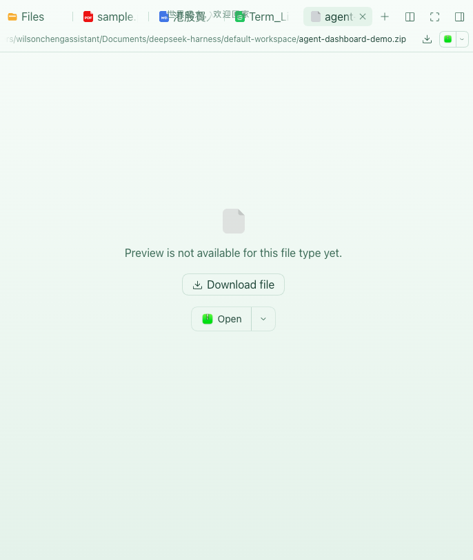

# dsh-file-io

**Move files both ways between a DSH workspace and the browser you are reading
from**: download any file the Sidebar previews, and upload one file back into
the workspace.

[](LICENSE)

> **Based on [`dsh-file-download`](https://github.com/wilsonchengassistant/dsh-file-download)
> by Wilson Cheng.** The download route, its controls, and their behavior come
> from that project; this extension adds the upload direction and packages both
> halves as `dsh-file-io`. See [Credit](#credit).


## Why

DeepSeek Harness's document preview renders a file instead of handing it to
you: an XLSX becomes a grid, a PDF becomes pages, an image becomes pixels. When
the reader is **not** sitting at the Host — a phone, another laptop, a Tailscale
peer — the preview has no download action, and the only file action in the
header is **Open**, which launches the file in an application on the Host.
`/api/file` is not a substitute: it sends the file's own `Content-Type` with no
`Content-Disposition`, so the browser renders it, and it caps the body at the
image-attachment limit (~20 MB).

The reverse direction had the same gap: there was no way to put a file from the
browser into the workspace the Sidebar browses.



## What it does

### Download

Host route `GET/HEAD /api/file-download?path=<absolute path>`:

- Streams in 1 MB chunks — never buffered whole, never capped at an
  image-sized limit.
- Answers `Content-Disposition: attachment`, with an ASCII fallback and an RFC
  5987 `filename*`, so `投資計劃_2026.xlsx` saves under its real name.
- Supports `Range` / `206` / `Content-Range` / `416`, so an interrupted download
  resumes.
- `Content-Type: application/octet-stream` + `nosniff`: the response can never
  become a document in the browser.

Browser controls in two existing extension points:

- `sidebar.right.tab.document.actions` — the document preview header, for every
  renderer (PDF, XLSX, DOCX, images, HTML, Markdown, text, media).
- `sidebar.right.tab.document.unpreviewable` — the empty state, where the stock
  UI only offers **Open**; a labelled **Download file** button sits above it.

Both are plain `<a download>` links, so middle-click and _Save link as_ work.

### Upload

Host route `POST /api/file-upload?sessionId=<id>&directory=<absolute path>&name=<file name>`:

- Receives one raw `application/octet-stream` body and confines the destination
  to that Session's workspace root.
- Refuses a read-only Session, a destination outside the workspace, and an
  execution world whose filesystem is not the Host's.
- Stages the body in a hidden `.dsh-upload-*.part` sibling and publishes it with
  one `rename`; an interrupted, refused, oversized, or errored transfer deletes
  the staging file, so the workspace never shows a partial entry.
- Caps one file at **100 MiB**, checked from `Content-Length` and enforced again
  while streaming.
- Refuses an existing name (`409`) instead of overwriting it, and allows one
  upload per Session at a time (`429` for a concurrent request).

Browser control in `sidebar.right.tab.files.actions`, the workspace file view's
top-right action row:

- Click the upload icon, pick one file, and the Host stores it in the displayed
  directory.
- While uploading, the button is a single circular progress ring whose arc
  follows `XMLHttpRequest.upload` progress; the percentage is also in the
  tooltip and accessible label. A second selection is refused until the first
  finishes.
- Success, refusal, and transport failures appear in a toast. A refused file
  leaves the workspace untouched, and the file tree shows a successful upload
  through its own directory watch.

### Routes

| Route                                             | Methods   | Purpose                              |
| ------------------------------------------------- | --------- | ------------------------------------ |
| `/api/file-download?path=…`                       | GET, HEAD | Stream one file as an attachment.    |
| `/api/file-upload?sessionId=…&directory=…&name=…` | POST      | Receive one file into the workspace. |

Both live under `/api`, so the Connection carrier's authentication and trust
fence apply before either handler runs. Upload failures answer JSON with a
stable code that the browser localizes.

## Behavior and limits

- **One upload at a time.** Uploads are serialized per Session in the browser
  and again on the Host; downloads are independent.
- **100 MiB per upload.** Checked in the browser before any bytes are sent and
  enforced again while the Host streams.
- **No silent overwrite.** An existing name, or a non-file at that name, is
  refused with `409` and left untouched.
- **Atomic publication.** The final name appears only after the complete body
  has been received; a failure deletes the staging file.
- **Host-local filesystem only.** Raw bytes are published through the Host
  filesystem; a remote execution world is refused rather than written to the
  wrong machine.
- **Downloads are unbounded in size** and stream in chunks; no image-sized cap.

## Install

The plugin is a profile-local package. From a checkout:

```bash
dsh plugin --profile <profile> add file:/absolute/path/to/dsh-file-io
```

Or add it to the profile's `package.json`:

```jsonc
{
  "dependencies": { "dsh-file-io": "file:/absolute/path/to/dsh-file-io" },
  "dsh": { "profile": { "bundles": [, /* … */ "dsh-file-io"] } },
}
```

Then install and reload the Host:

```bash
cd "$DSH_HOME/profiles/<profile>" && pnpm install
# restart dsh web, or reload the desktop app
```

Disable the original `dsh-file-download` plugin first: both claim the same
`/api` routes and extend the same Sidebar slots, so they must not be enabled
together.

## Localization

The browser half ships English and Simplified Chinese dictionaries. Traditional
Chinese comes from the separate
[`dsh-zh-hant`](https://github.com/wilsonchengassistant/dsh-zh-hant) language
pack, which converts this plugin's `zh` table under the retained
`fileDownload` namespace. The plugin itself deliberately registers no `zh-Hant`
dictionary: the locale service allows one dictionary per namespace and locale,
and the pack owns `zh-Hant`.

## Compatibility

| DSH          | Status              |
| ------------ | ------------------- |
| `0.2.2-rc.5` | download and upload |

The slots this plugin extends are declared by
`@deepseek-ai/dsh-client-ui-sidebar-documentpreview` and
`@deepseek-ai/dsh-client-ui-sidebar-files`; a future rename fails loudly at boot
(slot not found), never silently. The download half derives from a plugin also
verified on `0.2.0-rc.2`; the upload half requires the newer build.

## Development

```bash
npm test   # unit tests for the Host route helpers and the browser bundle
```

## Credit

`dsh-file-io` is derived from
[`dsh-file-download`](https://github.com/wilsonchengassistant/dsh-file-download)
by Wilson Cheng.

- The **download direction** — the `/api/file-download` route, its chunked
  streaming, `Range` handling, `Content-Disposition` encoding, and the two
  preview download controls — comes from that project.
- The **upload direction** — `/api/file-upload`, its atomic staging and
  publication, the files-page upload control, and this extension's packaging
  and documentation — was added here.

The original MIT copyright notice is retained in [LICENSE](LICENSE).

## License

MIT. See [LICENSE](LICENSE). Original work © Wilson Cheng.
